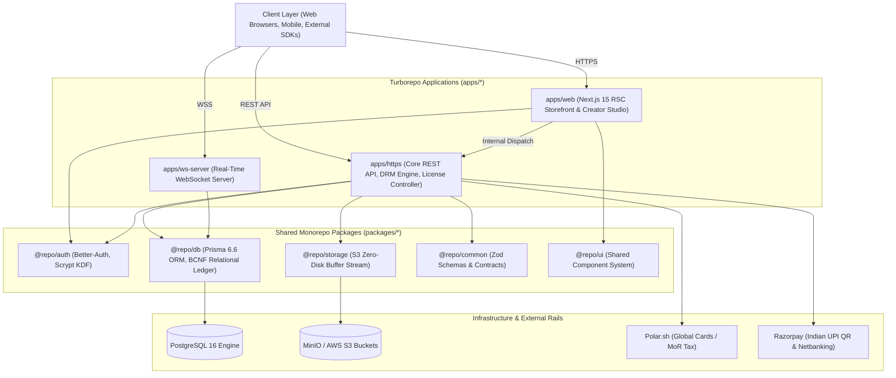

# DigiStore 🛍️
> **Autonomous Digital Goods Marketplace with Server-Side Forensic DRM, Cryptographic Licensing, and Dual-Gateway Payment Orchestration**

[](https://turbo.build/)
[](https://bun.sh/)
[-000000.svg)](https://nextjs.org/)
[](https://www.prisma.io/)
[](https://min.io/)
[](#-cryptographic-software-licensing)

---

## 📌 Executive Summary

**DigiStore** is an enterprise-grade, autonomous digital goods marketplace designed to solve the critical vulnerabilities of modern creator commerce: high payment gateway lock-in, client-side DRM piracy, fraudulent license sharing, and high fees. 

Built as a high-performance **Turborepo monorepo** managed with **Bun**, DigiStore delivers an end-to-end platform featuring:
- **Server-Side Dynamic PDF DRM:** In-memory bytecode watermarking with 45° affine coordinate transforms and steganographic purchaser tracing without client software dependencies.
- **Gumroad v2-Compatible Cryptographic Licensing:** 48-bit CSPRNG keys ($S = 2^{48}$ entropy space) coupled with SHA-256 hardware node-locking ($F_m$) and remote de-provisioning.
- **Dual-Gateway Payment Orchestration:** Frictionless domestic UPI via **Razorpay** alongside global **Polar.sh** Merchant of Record (MoR) with automated sales tax and VAT compliance.
- **Ultra-Fast Trigram Search Engine:** Sub-15ms search across thousands of digital products using PostgreSQL native GIN trigram indexes.
- **Real-Time Telemetry & WebSocket Infrastructure:** Bi-directional live transaction notifications and creator analytics synchronization.

---

## 🏗️ System Architecture & Workspace Topology

DigiStore is structured as an isolated, modular Turborepo monorepo. It enforces strict architectural boundaries, zero circular dependencies, and decoupled package lifecycles:

```
finalyr/
├── apps/
│   ├── web/               # Next.js 15 (App Router, RSC, Tailwind CSS)
│   ├── https/             # Node.js / Express Core RESTful API & DRM Engine
│   └── ws-server/         # Node.js WebSocket Microservice for Live Events
├── packages/
│   ├── auth/              # Better-Auth Engine, Scrypt Hashing, Session Management
│   ├── db/                # Prisma 6.6 ORM Layer, BCNF PostgreSQL Models & Migrations
│   ├── storage/           # MinIO / AWS S3 Zero-Disk Streaming Client
│   ├── common/            # Shared Zod Schemas, Validation Contracts & Constants
│   ├── ui/                # Shared React Components & Design System Tokens
│   ├── typescript-config/ # Strict Monorepo TypeScript Configurations
│   └── eslint-config/     # Shared Linting Rules
├── docker/                # Multi-stage Container Definitions (Frontend, API, WS)
├── research paper/        # IEEE Conference Deliverable, OMML Equations & Excalidraw Diagrams
├── docker-compose.yml     # Complete Multi-Container Local Cluster Setup
└── package.json           # Bun Workspaces & Turbo Pipeline Definitions
```

### High-Level Architectural Flow



---

## ⚡ Core Technical Features

### 1. 🛡️ Dynamic Server-Side Forensic PDF DRM
- **Zero-Disk In-Memory Execution:** Streams raw PDF bytes from MinIO/S3 into memory buffers via `pdf-lib` without writing unwatermarked files to server disks.
- **Affine Coordinate Transformation:** Dynamically computes diagonal centering:
  $$\Delta x = \frac{W_p - w_t}{2}, \quad \Delta y = \frac{H_p - h_t}{2}, \quad \theta = 45^\circ$$
- **Forensic Anti-Piracy Stamping:** Injects visible forensic banners and subtle steganographic metadata containing the purchaser's email, cryptographic order UUID, and UTC timestamp with non-intrusive alpha blending ($\alpha = 0.18$).

### 2. 🔑 Cryptographic Software Licensing & Node-Locking
- **CSPRNG Key Generation:** Generates 48-bit cryptographically secure pseudorandom keys yielding an entropy space of $S = 2^{48}$ combinations ($2.81 \times 10^{14}$).
- **Hardware Machine Fingerprinting ($F_m$):** Normalizes and binds client hardware identifiers (CPU ID, motherboard UUID, disk serial) using SHA-256 to enforce seat capacity ($u \le u_{\max}$).
- **Gumroad v2 Specification Compatibility:** Seamlessly integrates with remote clients via standard `POST /api/licenses/verify` and `POST /api/licenses/decrement` endpoints.

### 3. 💳 Dual-Gateway Payment Orchestration
- **Geolocation & Currency Switcher:** Dynamically routes transactions between domestic Indian UPI (`INR`) and global card payments (`USD`, `EUR`).
- **Polar.sh Integration:** Merchant of Record (MoR) coverage automating global sales tax, EU/UK VAT compliance, Apple Pay, and Google Pay.
- **Razorpay Integration:** Zero-surcharge, dynamic QR-code-based Indian UPI payments with instant webhook settlement.
- **HMAC-SHA256 Idempotent Webhook Guard:** Rejects replay attacks and processes order fulfillment atomically via database transaction idempotency tables.

### 4. 🔍 Hyphen-Insensitive Trigram Search Engine
- Sub-15ms search across product catalogs, categories, and tags using PostgreSQL native GIN trigram indexes (`pg_trgm`).
- Normalizes search queries by stripping punctuation, hyphens, and whitespace for robust, typo-tolerant fuzzy matching.

---

## 🚀 Getting Started

### Prerequisites

- [Bun](https://bun.sh/) (v1.3.4+ or v1.4+) **(Required)**
- [Node.js](https://nodejs.org/) (v20+)
- [Docker Desktop](https://www.docker.com/) (for PostgreSQL & MinIO container services)

> ⚠️ **Note:** This monorepo is strictly configured for **Bun**. Do not run `npm install`.

---

### Method A: Local Development (Recommended)

#### 1. Clone & Install Dependencies
```bash
git clone https://github.com/Riyan081/finalyr.git
cd finalyr
bun install
```

#### 2. Configure Environment Variables
Copy and configure the necessary environment files:
- `apps/https/.env` (Backend API keys, Database URL, S3 credentials)
- `apps/web/.env.local` (Frontend Next.js configuration)
- `packages/db/.env` (Database connection string)
- `apps/ws-server/.env` (WebSocket port and DB URL)

*(Refer to [SETUP_GUIDE.md](SETUP_GUIDE.md) for full `.env` variable templates).*

#### 3. Start Database & MinIO (Docker)
```bash
# Start Postgres & MinIO in background
docker compose up -d db minio
```

#### 4. Initialize Database Schema
```bash
bun run db:generate
cd packages/db
bunx prisma db push
bunx prisma db seed
cd ../..
```

#### 5. Launch All Dev Servers
```bash
bun run dev
```

Turborepo will concurrently spin up:
- 🌐 **Web Storefront & Creator Studio:** `http://localhost:3000`
- ⚙️ **RESTful API Backend:** `http://localhost:3001`
- 🔌 **WebSocket Server:** `ws://localhost:8080`

---

### Method B: Full Containerized Execution (Docker Compose)

To spin up the entire production-like cluster (Frontend, Backend, WebSocket, Database, and MinIO) with zero manual environment setup:

```bash
docker compose up --build
```

To stop all running services:
```bash
docker compose down
```

---

## 💻 Available Scripts & Commands

All workspace commands are managed through `bun` and `turbo`:

| Command | Action |
| :--- | :--- |
| `bun install` | Installs dependencies across all 10 monorepo packages |
| `bun run dev` | Starts all applications concurrently with hot-reloading |
| `bun run build` | Builds optimized production bundles across all workspaces |
| `bun run check-types` | Executes strict TypeScript compilation checks (`tsc --noEmit`) |
| `bun run lint` | Runs ESLint across all apps and shared packages |
| `bun run format` | Formats all code files using Prettier |
| `bun run db:generate` | Regenerates Prisma Client v6.6.0 for `@repo/db` |
| `bun run db:seed` | Seeds database with 14 users and 20 multi-category products |
| `bun run start:web` | Starts the Next.js standalone web server |
| `bun run start:https` | Starts the Express REST API backend |
| `bun run start:ws` | Starts the real-time WebSocket service |

---

## 🧪 Testing & Verification

Run the comprehensive route test suite to verify all endpoints across authentication, payments, licensing, and DRM:

```bash
bun run test-all-routes.js
```

To run strict static type checking across all 10 packages:
```bash
bun run check-types
```

---

## 📄 Academic Research Paper & Deliverables

This repository contains the complete academic publication deliverable for the final-year capstone project:

- **Paper Title:** *DigiStore: An Autonomous Digital Goods Marketplace with Server-Side Forensic DRM, Cryptographic Licensing, and Dual-Gateway Payment Orchestration*
- **Target Venue:** IEEE Conference 2-Column Standard
- **Production Document:** [`research paper/DigiStore_IEEE_Research_Paper.docx`](research%20paper/DigiStore_IEEE_Research_Paper.docx) (Strict 8-Page IEEE compliance with native OMML fraction math)
- **Manuscript Source:** [`research paper/DigiStore_IEEE_Research_Paper.md`](research%20paper/DigiStore_IEEE_Research_Paper.md)
- **High-Resolution Vector Diagrams:** Authored in [Excalidraw](https://excalidraw.com) in [`research paper/diagrams/`](research%20paper/diagrams/)
- **Comprehensive Project Reference:**
  - [`PROJECT_DOCUMENTATION.md`](PROJECT_DOCUMENTATION.md) — 1,600+ line technical manual
  - [`PROJECT_BLACK_BOOK.md`](PROJECT_BLACK_BOOK.md) — Capstone project documentation
  - [`SETUP_GUIDE.md`](SETUP_GUIDE.md) — Step-by-step developer deployment guide

---

## 👥 Authors & Acknowledgments

- **Aditya** — Project Architect & Lead Engineer ([@Riyan081](https://github.com/Riyan081))
- **Institution:** Department of Computer Engineering
- **Year:** Final Year Capstone Project (2026)

---

## 📜 License

This project is licensed under the [MIT License](LICENSE).
